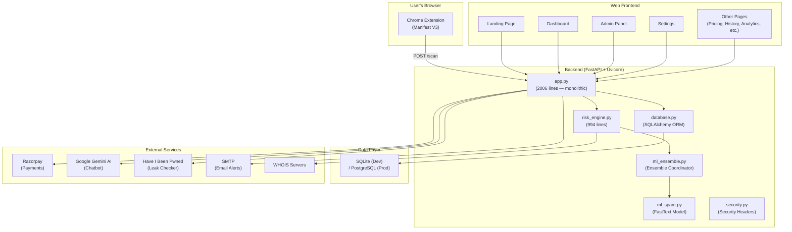
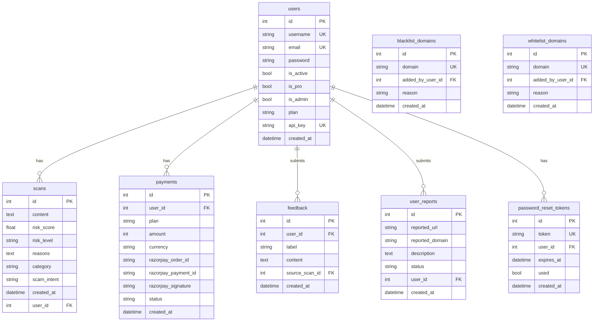

# Block Bord AI — Complete Project Analysis

## What Is This Project?

**Block Bord AI** is a **SaaS cybersecurity platform** with an accompanying **Chrome browser extension** that protects users from phishing, scams, and malicious websites in real-time.

Think of it as a **personal cybersecurity shield** — users install the Chrome extension, and as they browse the web, the extension silently sends every website's content to the backend for analysis. The backend uses a multi-layered detection engine (80+ heuristic rules + machine learning) to assign a risk score, and if a site is dangerous, the extension shows a warning overlay.

The platform also has a **web dashboard** where users can view their scan history, analytics, and manage their account. There's a **monetization layer** via Razorpay (Indian payment gateway) with subscription tiers. Admins get a full admin panel for user management, threat intelligence, and domain blacklisting/whitelisting.

---

## Architecture Overview

---

## Technology Stack

| Layer | Technology |
|---|---|
| **Backend Framework** | Python 3.9+ / FastAPI (ASGI via Uvicorn) |
| **Frontend** | HTML5 + Vanilla CSS + Jinja2 Templates — server-side rendered |
| **Database** | SQLite (dev) / PostgreSQL (prod) via SQLAlchemy ORM |
| **Browser Extension** | Chrome Manifest V3 (JavaScript) |
| **ML Model** | FastText (spam classification via `fasttext` library) |
| **Payment Gateway** | Razorpay (Indian market, ₹ pricing) |
| **AI Chatbot** | Google Gemini 1.5 Flash (optional) |
| **Password Hashing** | Argon2 (via `passlib`) |
| **Rate Limiting** | SlowAPI |
| **Deployment** | Docker + Docker Compose, Render/Railway (Procfile) |

---

## Feature Inventory

### 🛡️ Core Security Features
| Feature | Description | Status |
|---|---|---|
| **URL/Text Risk Scanning** | 80+ heuristic checks (SSL, WHOIS, DNS, brand impersonation, etc.) | ✅ Built |
| **ML Spam Detection** | FastText model for spam probability scoring | ✅ Built (model file missing) |
| **Chrome Extension** | Manifest V3 — auto-scans every page user visits | ✅ Built |
| **Phishing Detection** | Keyword-based + domain structural analysis | ✅ Built |
| **UPI Scam Detection** | India-specific UPI payment fraud detection | ✅ Built |
| **Brand Impersonation** | Detects fake Google/PayPal/Bank login pages | ✅ Built |
| **SSL Certificate Check** | Verifies HTTPS, expiry, self-signed, domain mismatch | ✅ Built |
| **WHOIS Domain Age** | Flags newly registered domains | ✅ Built |
| **Fast-Flux DNS** | Detects rapidly-changing IP addresses | ✅ Built |
| **Malware Signal Detection** | Detects dangerous file downloads, fake virus warnings | ✅ Built |
| **Favicon Hash Matching** | Compares favicon hashes against phishing kit database | ✅ Built |

### 👤 User Features
| Feature | Description | Status |
|---|---|---|
| **User Registration/Login** | Username + email + password (Argon2 hashed) | ✅ Built |
| **Password Reset** | Token-based reset flow | ✅ Built |
| **Dashboard** | Shows scan stats, 7-day timeline, security score | ✅ Built |
| **Scan History** | Full history of all scanned URLs/pages | ✅ Built |
| **Scan Detail Page** | Detailed risk breakdown for each scan | ✅ Built |
| **CSV Export** | Export scan history as CSV | ✅ Built |
| **Threat Analytics** | 30-day timeline chart | ✅ Built |
| **Password Leak Checker** | Checks email against HIBP (or mock fallback) | ✅ Built |
| **AI Chatbot** | Cybersecurity assistant (Gemini or rule-based fallback) | ✅ Built |
| **Global Scam Map** | Visual world map of scam activity | ✅ Built |
| **User Report Submission** | Users can report malicious URLs | ✅ Built |
| **Settings Page** | API key generation, account management | ✅ Built |

### 💰 Monetization
| Feature | Description | Status |
|---|---|---|
| **Pricing Tiers** | Free (10/day), Starter (50/day, ₹99), Pro (unlimited, ₹199), Business (unlimited, ₹499) | ✅ Built |
| **Razorpay Integration** | Full checkout + payment verification + webhook | ✅ Built |
| **Test Mode** | Payment simulation for local dev | ✅ Built |
| **API Key System** | Pro users can generate API keys for programmatic access | ✅ Built |

### 🔧 Admin Features
| Feature | Description | Status |
|---|---|---|
| **Admin Panel** | View all system scans | ✅ Built |
| **User Management** | List, set plan, toggle admin, suspend/reactivate users | ✅ Built |
| **Domain Blacklist** | Add/remove blacklisted domains | ✅ Built |
| **Domain Whitelist** | Add/remove whitelisted domains | ✅ Built |
| **Report Management** | Review user-submitted URL reports | ✅ Built |
| **Platform Stats** | Total users, scans, plan breakdown | ✅ Built |

### 📄 Static Pages
Landing, About, Pricing, Contact, Privacy Policy, Terms of Service, Cookie Policy, Status, Extension Setup Guide.

---

## File-by-File Breakdown

### Backend (Python)
| File | Lines | Purpose |
|---|---|---|
| [app.py](file:///c:/Users/dhanu/OneDrive/Documents/block-bord/app.py) | **2,006** | ⚠️ MONOLITH — Contains ALL routes, middleware, business logic in one file |
| [risk_engine.py](file:///c:/Users/dhanu/OneDrive/Documents/block-bord/risk_engine.py) | **994** | Core threat detection engine (heuristics + ML blending) |
| [database.py](file:///c:/Users/dhanu/OneDrive/Documents/block-bord/database.py) | **226** | SQLAlchemy models + table definitions + migrations |
| [ml_spam.py](file:///c:/Users/dhanu/OneDrive/Documents/block-bord/ml_spam.py) | **77** | FastText model loading, prediction, and training |
| [ml_ensemble.py](file:///c:/Users/dhanu/OneDrive/Documents/block-bord/ml_ensemble.py) | **11** | Ensemble coordinator (currently just a pass-through) |
| [security.py](file:///c:/Users/dhanu/OneDrive/Documents/block-bord/security.py) | **24** | Security headers middleware (CSP, X-Frame-Options, etc.) |
| [make_admin.py](file:///c:/Users/dhanu/OneDrive/Documents/block-bord/make_admin.py) | **31** | CLI tool to grant admin access |
| [update_datasets.py](file:///c:/Users/dhanu/OneDrive/Documents/block-bord/update_datasets.py) | **39** | Checks for ML model files (doesn't actually download anything) |

### Frontend
| File | Purpose |
|---|---|
| [style.css](file:///c:/Users/dhanu/OneDrive/Documents/block-bord/static/style.css) | Master stylesheet (~49KB) |
| [script.js](file:///c:/Users/dhanu/OneDrive/Documents/block-bord/static/script.js) | Client-side JavaScript (~25KB) |
| 26 HTML templates | Jinja2 templates in `templates/` |

### Chrome Extension
| File | Purpose |
|---|---|
| [manifest.json](file:///c:/Users/dhanu/OneDrive/Documents/block-bord/extension/manifest.json) | Manifest V3 config |
| [background.js](file:///c:/Users/dhanu/OneDrive/Documents/block-bord/extension/background.js) | Service worker — triggers scans |
| [content.js](file:///c:/Users/dhanu/OneDrive/Documents/block-bord/extension/content.js) | Content script — scrapes page content, shows warning overlays |
| [popup.html](file:///c:/Users/dhanu/OneDrive/Documents/block-bord/extension/popup.html) / [popup.js](file:///c:/Users/dhanu/OneDrive/Documents/block-bord/extension/popup.js) / [popup.css](file:///c:/Users/dhanu/OneDrive/Documents/block-bord/extension/popup.css) | Extension popup UI |

### Tests
| File | Tests |
|---|---|
| [test_app.py](file:///c:/Users/dhanu/OneDrive/Documents/block-bord/tests/test_app.py) | **2 tests** — landing page + status page (bare minimum) |
| [test_risk_engine.py](file:///c:/Users/dhanu/OneDrive/Documents/block-bord/tests/test_risk_engine.py) | **2 tests** — UPI scam detection + safe text |

---

## Database Schema

---

## 🚨 Issues & Production-Readiness Gaps

### Critical (Must Fix)

| # | Issue | Details |
|---|---|---|
| 1 | **Monolithic `app.py` (2,006 lines)** | ALL routes, business logic, middleware, and helpers are in one file. Unmaintainable. Must be split into modules/routers. |
| 2 | **`/upgrade` endpoint is a free plan bypass** | `GET /upgrade` upgrades any user to Pro with zero payment. Critical security hole. |
| 3 | **`/downgrade` endpoint has no CSRF** | `GET /downgrade` can be triggered by a simple link click (CSRF via GET). |
| 4 | **Webhook uses `hmac.new()` instead of `hmac.HMAC()`** | Line 1978: `hmac.new(...)` is wrong — Python's HMAC module doesn't have a `.new()` function. This will crash at runtime. Should be `hmac.HMAC(...)`. |
| 5 | **Duplicate `/api/scam-stats` endpoint** | The endpoint is defined TWICE (lines 606 and 1299), the second will silently override the first. |
| 6 | **CORS wildcard in production** | `CORS_ORIGIN_REGEX` defaults to `r".*"` — allows ANY origin. Must be restricted. |
| 7 | **`docker-compose.yml` leaks dev secrets** | `SESSION_SECRET=dev_only_change_me` is hardcoded in docker-compose — would crash with the production guard OR use a weak secret. |
| 8 | **No password validation** | Users can register with 1-char passwords. No min length, complexity, or strength checks. |
| 9 | **SQLite in production** | While PostgreSQL support exists, the default is SQLite which won't handle concurrent writes. |

### High Priority

| # | Issue | Details |
|---|---|---|
| 10 | **Duplicate imports scattered throughout** | `import secrets`, `import ast`, `from fastapi.responses import ...` etc. appear multiple times inline throughout `app.py`. |
| 11 | **`norm()` function defined 3 times** | Same helper function is defined at module level AND re-defined inside `dashboard()` AND `get_security_stats()`. |
| 12 | **Auto-retrain loop uses deprecated `@app.on_event("startup")`** | FastAPI deprecated this in favor of lifespan events. |
| 13 | **No logging framework** | The entire app uses `print()` statements. No structured logging (should use Python `logging` module). |
| 14 | **Reasons stored as Python repr string** | Scan reasons are stored as `str(list)` and parsed back with `ast.literal_eval()` — fragile and dangerous. Should use JSON. |
| 15 | **ML model files are missing** | `models/spam_model.bin` doesn't exist. `update_datasets.py` doesn't actually download anything — just checks if files exist. |
| 16 | **`scikit-learn` in requirements but unused** | `sklearn_model.joblib` is referenced in `update_datasets.py` but no sklearn code exists. Dead dependency. |
| 17 | **Test coverage is near zero** | Only 4 tests total. No tests for auth, scanning, admin, payments, or any API endpoints. |
| 18 | **CSP `connect-src` hardcoded to localhost** | `security.py` hardcodes `http://127.0.0.1:8000` — will break in production. |

### Medium Priority

| # | Issue | Details |
|---|---|---|
| 19 | **No database migrations tool** | Uses a hand-rolled `run_migrations()` with raw SQL. Should use Alembic. |
| 20 | **Extension hardcoded to `localhost:8000`** | The Chrome extension's `manifest.json` and JS only connect to `http://127.0.0.1:8000`. |
| 21 | **`same_site="none"` in production sessions** | This requires `Secure` + `HTTPS` and may cause issues. Line 267. |
| 22 | **No email verification on signup** | Users can register with any email without verification. |
| 23 | **`datetime.utcnow()` is deprecated** | Should use `datetime.now(timezone.utc)` (PEP 495). |
| 24 | **Mock/simulated data in production-facing endpoints** | Leak checker returns fake breach data, scam map uses randomized data. These need to be clearly marked or disabled. |
| 25 | **`.env` file is tracked in git** | The actual `.env` with secrets should not be in the repo. `.gitignore` may not be properly excluding it. |
| 26 | **No health check endpoint** | No `/health` or `/ready` endpoint for container orchestration. |
| 27 | **`__pycache__` committed to repo** | Should be in `.gitignore`. |
| 28 | **`blockbord.db` committed to repo** | SQLite database file should not be in version control. |

### Low Priority / Polish

| # | Issue | Details |
|---|---|---|
| 29 | **No API versioning** | Routes use `/api/` but no versioning (e.g., `/api/v1/`). |
| 30 | **No OpenAPI documentation tags** | FastAPI auto-docs have no route grouping/tags. |
| 31 | **Procfile only runs one process** | `web: uvicorn app:app --host 0.0.0.0 --port $PORT` — no worker process. |
| 32 | **No Gunicorn for production** | Uvicorn alone is single-process. Should use Gunicorn + Uvicorn workers. |
| 33 | **Redundant `ml_ensemble.py`** | Just a pass-through to `ml_spam.py` with 11 lines. Could be inlined. |

---

## Summary

> **Block Bord AI is a feature-rich cybersecurity SaaS platform with a Chrome extension.** The concept and feature set are impressive — 80+ heuristic rules, ML integration, payment gateway, admin panel, and a browser extension. However, the codebase has significant structural and security issues that make it **not production-ready**.

The biggest concerns are:
1. **A 2,006-line monolithic `app.py`** that needs to be refactored into modular routers
2. **Critical security vulnerabilities** (free upgrade endpoint, CORS wildcard, weak session handling)  
3. **Broken code** (`hmac.new()` will crash, duplicate routes)
4. **No proper test coverage** (4 tests for 3,000+ lines of backend code)
5. **Missing ML model files** and dead dependencies

> [!IMPORTANT]
> Before we start making changes, please let me know:
> 1. **What's the timeline?** Is this urgent or do we have time for a proper refactor?
> 2. **What does "production ready" mean to your client?** Deploy to a hosting service? Handle real users? Pass a security audit?
> 3. **Do we need to preserve the existing database** (users, scans, etc.) or can we start fresh?
> 4. **Should the Razorpay integration work** with real keys, or is test mode sufficient for now?
